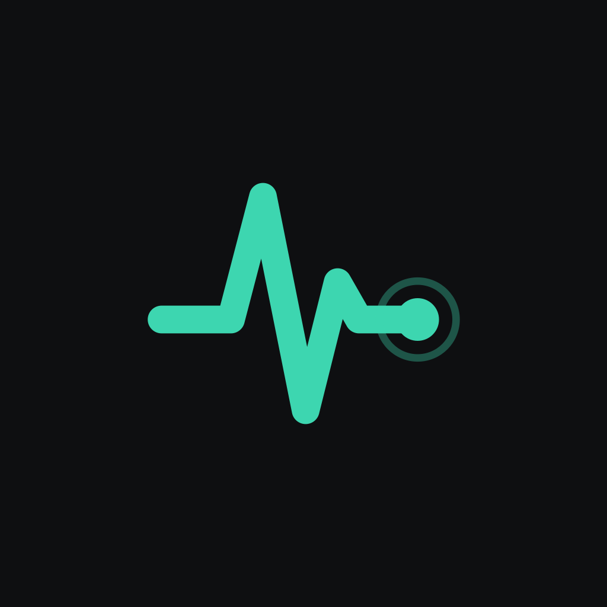
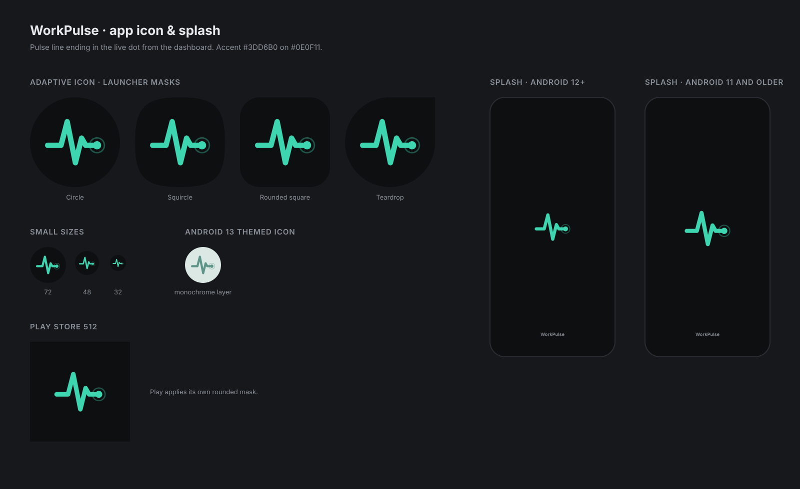

<p align="center">
  
</p>

<h1 align="center">WorkPulse</h1>

<p align="center">
  <strong>Understand your working day without keeping a work log.</strong>
</p>

<p align="center">
  An Android app that pieces together where your day went, using activity you
  already generate. Everything stays on your phone.
</p>

---

## The vision

At the end of a long day it is surprisingly hard to say where the time went.
Timers only work if you remember to start them, and writing a log afterwards
means reconstructing the day from memory.

WorkPulse takes a different approach. Your phone already knows which apps you
used, GitHub already knows what you shipped, and your editor already knows when
you were coding. WorkPulse brings those signals together into one honest
picture of your day, with nothing to start, stop or fill in.

That picture belongs to you. There is no WorkPulse server and no team
dashboard. The pulse in the logo is the idea in one mark: a steady reading of
your work, ending in the live dot for what is happening right now.

## Three promises

| | Promise | What it means |
| --- | --- | --- |
| 📱 | **Stays on this device** | A local SQLite database. There is no WorkPulse server. |
| 🛡️ | **Metadata, never content** | No keystrokes, screens, notifications or messages. |
| 🔗 | **Every source is opt-in** | Connect each source separately and disconnect it at any time. |

WorkPulse is also careful about what it claims to know. It reports observed app
and session time, not verified work time, and on the timeline anything it
guessed is marked as inferred, with a confidence percentage.

## What you get

| | Screen | What it answers |
| --- | --- | --- |
| 💓 | **Home** | How is today going, and what is live right now? |
| 🕒 | **Timeline** | What did I do, in order, and what was observed or inferred? |
| 📁 | **Projects** | Which project did my time go to, by repository or by your own rules? |
| 📊 | **Insights** | How do my week and month look, across projects, AI assistants and phone apps? |
| 📓 | **Journal** | Can I get a daily or weekly report to copy as plain text? |

You stay in control with a Private session that pauses recording, excluded apps,
a biometric app lock, and a one-step Delete all data.

## Where the data comes from

| Source | What it adds | How it connects |
| --- | --- | --- |
| **Android app usage** | Time spent in each app | Android's Usage Access permission |
| **GitHub** | Commits, pull requests, reviews and issues | Device Flow sign-in, read-only use |
| **Claude Code** | Session times, folder and repository names | Small script, paired over your local network |
| **VS Code** | Coding time | Extension, using the same pairing |

**Planned:** a browser extension for ChatGPT, Claude and website time, GitLab and
GitHub Enterprise, local AI summaries through Ollama, and data export.

## The look

One accent colour on deep charcoal. The icon, the Android splash screens and
the themed icon all come from the same pulse mark.

<p align="center">
  
</p>

## Status

WorkPulse is in active development and is Android only. There is no store
release yet, so for now you build it from source.

Every design screen is built. Android usage tracking drives Home, Timeline,
Activity detail and app exclusions, and it catches up from Android's usage log
each time the app opens. Onboarding, sign-in, Profile, sign-out, Private
session and Delete all data are also real, and Projects, Insights and Journal
are built from recorded activity. GitHub
connects with Device Flow and syncs commits, pull requests, reviews and issues.

The database tables other than `users` were derived from the design canvas,
because the original spec's §6 was not available. See `lib/core/database/tables.dart`.

---

# For developers

Built with Flutter, Riverpod, go_router and drift.

Design canvas: https://claude.ai/artifact/YNF37ooFtoH4Rq3DEYAMdm
Build notes: [build-handoff.md](build-handoff.md)

## Claude Code

`companion/claude-code/workpulse_claude.py` reports Claude Code session times
to the phone over the local network. It needs only Python 3.8+. Open
**Integrations → Claude Code** in the app for the pairing commands. Sessions
send only times, the folder name and the repository name; events are signed
but not encrypted on the local network.

## VS Code

`companion/vscode` is a dependency-free extension that sends coding time over
the same pairing. Package it with
`npx @vscode/vsce package --allow-missing-repository --skip-license`.

## Layout

```
lib/app/             router, bottom-nav shell
lib/core/            theme tokens, database, shared widgets
lib/features/<name>/ domain, data, presentation
drift_schemas/       committed schema dumps, one per version
```

## Commands

```sh
flutter pub get
flutter analyze
flutter test
flutter build apk --debug
dart run build_runner build   # after changing tables
```

To change the schema: edit `tables.dart`, bump `schemaVersion`, run
`dart run drift_dev make-migrations`, and wire the generated steps into
`AppDatabase.migration`.

## Credentials

All client IDs and signature hashes live in `.env` at the project root, which
is git-ignored. Anything left empty shows as "not configured" in the app.

| Key | Where it comes from |
| --- | --- |
| `GITHUB_CLIENT_ID` | GitHub OAuth App with Device Flow enabled |
| `GOOGLE_SERVER_CLIENT_ID` | Google Cloud, Web OAuth client |
| `MSAL_CLIENT_ID` | Azure App registration |
| `MSAL_REDIRECT_URI` | `msauth://com.workpulse.app/<url-encoded signature hash>` |
| `MSAL_SIGNATURE_HASH_DEBUG` | Base64 hash of the debug signing key |
| `MSAL_SIGNATURE_HASH_RELEASE` | Base64 hash of the release signing key |

```sh
flutter run --dart-define-from-file=.env
```
